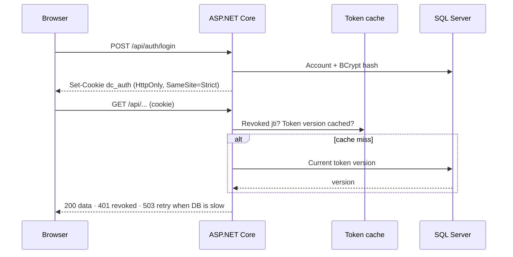

<div align="center">



<p>
  <strong>A dental clinic platform engineered like a product, not a demo.</strong><br>
  <sub>Online booking · appointment CRM · realtime notifications · secure sessions · in-page routes · AI assistant · 5 languages</sub>
</p>

<p>
  <a href="README.md"></a>
  <a href="README.ru.md"></a>
</p>

<p>
  <a href="https://dental-clinic-vn.vercel.app/"></a>
  <a href="docs/README.md"></a>
  <a href="docs/en/ARCHITECTURE.md"></a>
  <a href="docs/en/API.md"></a>
  <a href="docs/en/SECURITY.md"></a>
</p>

<p>
  <a href="https://github.com/ViolettaNcl/DentalClinic/actions/workflows/ci.yml"></a>
  <a href="https://github.com/ViolettaNcl/DentalClinic/actions/workflows/e2e.yml"></a>
  <a href="https://github.com/ViolettaNcl/DentalClinic/actions/workflows/codeql.yml"></a>
  <a href="https://github.com/ViolettaNcl/DentalClinic/actions/workflows/production-smoke.yml"></a>
  
  <a href="LICENSE"></a>
</p>

<p>
  <a href="#showcase">Showcase</a> ·
  <a href="#features">Features</a> ·
  <a href="#whats-new">What's new</a> ·
  <a href="#architecture">Architecture</a> ·
  <a href="#quality">Quality</a> ·
  <a href="#quick-start">Quick start</a> ·
  <a href="#documentation">Docs</a>
</p>

</div>


<a id="showcase"></a>
## 🎬 Showcase

<p align="center">
  
</p>

<p align="center"><sub>Real screens from the current build: home, service catalogue, doctor profiles and a route built inside the contact page — with the mobile layout alongside.</sub></p>

<a id="features"></a>
## ✨ What you get

<table>
<tr>
<td width="33%" valign="top">

### 🌐 Public site
- Service catalogue with live prices
- Doctor profiles and one-click booking
- Guest appointment requests
- **In-page routes** (car · walk · transit)
- Reviews with moderation and translation
- 5 languages incl. Arabic **RTL**

</td>
<td width="33%" valign="top">

### 👤 Patient workspace
- Registration and secure cookie sessions
- Appointment history and status
- Reschedule / cancel within clinic rules
- Profile, avatar, password change
- Reviews after completed visits
- **Realtime** notifications (SignalR)

</td>
<td width="33%" valign="top">

### 🏥 Clinic operations
- Appointment CRM and phone bookings
- Doctors, services and schedules
- Availability-aware calendar
- Analytics, XLSX and printable reports
- Multi-admin with super-admin safeguards
- Reminders and follow-ups automation

</td>
</tr>
<tr>
<td valign="top">

### 🤖 Denta assistant
- Answers from SQL-backed clinic facts first
- Gemini structured output for the rest
- Allow-listed links, safe booking hand-off
- Healthcare-safety rules, optional voice

</td>
<td valign="top">

### 🛡 Security by design
- JWT in `HttpOnly` + `SameSite=Strict` cookies
- Per-token logout, token-version revocation
- Same-origin checks, CORS allow-list
- Rate limits + SQL-backed distributed quotas

</td>
<td valign="top">

### ✨ Polished UX
- Motion layer: reveals, tilt, ripple, glow
- Symmetric header, mobile-first layouts
- No horizontal scroll from 320 px to 4K
- Honours `prefers-reduced-motion`

</td>
</tr>
</table>

<a id="whats-new"></a>
## 🚀 What's new

| | Change | Why it matters |
|:-:|---|---|
| 🔐 | **Reliable patient sign-in across instances.** Logout revokes only the current token (`jti`); database latency during session validation returns a retryable `503` instead of `401`. | Fresh logins and registrations are no longer rejected by another Vercel instance, and slow queries never log a patient out. |
| 🗺 | **Routes inside the contact page.** The map moved to the Yandex Maps widget with real driving, walking and transit directions, plus an "open in navigator" link. | The legacy Google embed was no longer framable and rendered an empty map. |
| ✨ | **Site-wide motion layer.** Scroll reveals, hero particles and cursor glow, 3D card tilt, ripple and shine, animated counters and modals. | A premium feel with one CSS file and one deferred script — no frameworks. |
| 📐 | **Symmetric header and responsive hardening.** Centred desktop navigation; header controls work from the first paint. | Consistent layout on every screen; fixed an E2E race on the language switcher. |
| ⚡ | **Cache-safe static assets.** HTML, JS, CSS and i18n revalidate via `ETag`. | Visitors never run a stale mix of ES modules after a deploy. |

Full history: [CHANGELOG.md](CHANGELOG.md).


<a id="architecture"></a>
## 🏗 Architecture

<p align="center">
  
</p>

One deployable **ASP.NET Core 10 modular monolith** owns the static frontend, REST API, SignalR hub, background workflows and database access. Controllers handle HTTP concerns, domain services own the rules, and SQL constraints are the last line of defence — so no single layer is the only guard.

<details>
<summary><strong>Request and session flow (Mermaid)</strong></summary>



</details>

Deep dive: [architecture guide](docs/en/ARCHITECTURE.md) — trust boundaries, request flows and design decisions.

## 🧰 Technology stack

| Layer | Stack |
|---|---|
| **Backend** |     |
| **Data** |    |
| **Security** |    |
| **Frontend** |     |
| **Integrations** |    |
| **Delivery** |     |
| **Testing** |     |

<a id="quality"></a>
## ✅ Quality gates

<table>
<tr>
<td align="center" width="25%"><h3>488</h3><sub>.NET unit &amp; integration tests</sub></td>
<td align="center" width="25%"><h3>200</h3><sub>JavaScript regression tests</sub></td>
<td align="center" width="25%"><h3>19</h3><sub>Playwright E2E checks<br>desktop + mobile</sub></td>
<td align="center" width="25%"><h3>1 h · 6 h</h3><sub>scheduled production<br>smoke · E2E</sub></td>
</tr>
</table>

| Workflow | What it proves |
|---|---|
| **CI** | Release build and the full .NET test suite on every push |
| **Production E2E** | Health, canonical URLs, accessibility (axe), languages + RTL, horizontal overflow, chat — on desktop and mobile |
| **CodeQL** | Static security analysis for C# and JavaScript |
| **Production smoke** | Scheduled health and public-route checks of the live site |
| **CD** | Test gate, GHCR image publication, optional FTPS fallback delivery |


<a id="quick-start"></a>
## ⚡ Quick start

> **Prerequisites:** [.NET SDK 10](https://dotnet.microsoft.com/download/dotnet/10.0) · SQL Server 2019+ or Azure SQL · Git · optional Node.js 22 (tests) and Docker Desktop

```bash
git clone https://github.com/ViolettaNcl/DentalClinic.git
cd DentalClinic
cp appsettings.Example.json appsettings.json   # PowerShell: Copy-Item appsettings.Example.json appsettings.json
dotnet tool restore && dotnet restore
dotnet ef database update
dotnet run --launch-profile http                # → http://localhost:5192 · Swagger at /swagger
```

Replace the example database, JWT, origin and clinic values in `appsettings.json` first — real secrets must never be committed.

<details>
<summary><strong>🐳 Run with Docker Compose</strong></summary>

```bash
cp .env.example .env      # replace every placeholder
docker compose up --build # → http://localhost:8080 · SQL Server on localhost:1433
```

</details>

<details>
<summary><strong>🧪 Run the test suites</strong></summary>

```bash
dotnet test DentalClinic.Tests/DentalClinic.Tests.csproj --configuration Release
npm install
npm run test:js
npx playwright install chromium
npm run test:e2e                      # targets the live site by default
BASE_URL=http://localhost:5192 npx playwright test   # or a local/approved environment
```

</details>

<details>
<summary><strong>⚙️ Configuration reference</strong></summary>

Environment variables use `__` for nested keys, e.g. `Jwt__Key`.

| Setting | Purpose | Requirement |
|---|---|---|
| `ConnectionStrings__DefaultConnection` | SQL Server connection | Required |
| `Jwt__Key` | HMAC signing secret, ≥ 32 UTF-8 bytes | Required |
| `Jwt__Issuer`, `Jwt__Audience` | Token validation boundaries | Required |
| `AllowedOrigins__0` | Trusted browser origin | Outside same-origin defaults |
| `Clinic__Phone`, `__Email`, `__Address`, `__Hours` | Public contact details shown on the site and map | Required for production content |
| `Clinic__Latitude`, `Clinic__Longitude` | Exact map pin and local ETA estimate | Recommended |
| `Scheduling__*` | Time zone, opening hours, slot interval, lead time | Recommended |
| `Gemini__ApiKey` | Denta and review translation | Required for AI features |
| `ElevenLabs__ApiKey` | Voice responses | Optional |
| `CRON_SECRET` | Vercel maintenance endpoint authentication | Required on Vercel |

See [Security](docs/en/SECURITY.md) before configuring any shared or production environment.

</details>

## 🧭 Operational boundaries

- **Medical safety** — Denta and the Smile Meter are informational, never diagnostic or treatment-planning tools.
- **Operations** — deployment needs operator-managed secrets, an external database and separately provisioned administrators.
- **Known limits** — no administrator MFA or password recovery yet; multi-instance SignalR needs a backplane; logout revocation is per instance. Details in [Security](docs/en/SECURITY.md).
- **Deployment status** — Vercel Git deployments are paused in `vercel.json`; production is deployed manually, while GitHub Actions still run on every push. See the [deployment guide](docs/en/DEPLOYMENT.md).

<a id="documentation"></a>
## 📚 Documentation

| | Guide | English | Русский |
|:-:|---|:-:|:-:|
| 🏗 | Architecture — components, trust boundaries, data flow | [Open](docs/en/ARCHITECTURE.md) | [Открыть](docs/ARCHITECTURE.md) |
| 📡 | REST API — routes, access rules, limits, errors | [Open](docs/en/API.md) | [Открыть](docs/API.md) |
| 🗃 | Data dictionary — entities, constraints, retention | [Open](docs/en/DATA_DICTIONARY.md) | [Открыть](docs/DATA_DICTIONARY.md) |
| 👨‍💻 | Developer guide — setup, migrations, tests | [Open](docs/en/DEVELOPER_GUIDE.md) | [Открыть](docs/DEVELOPER_GUIDE.md) |
| 🚀 | Deployment — Vercel, Docker, cron, release checks | [Open](docs/en/DEPLOYMENT.md) | [Открыть](docs/DEPLOYMENT.md) |
| 🔒 | Security — controls, secrets, residual risks | [Open](docs/en/SECURITY.md) | [Открыть](docs/SECURITY.md) |
| 👤 | User guide — visitors and patients | [Open](docs/en/USER_GUIDE.md) | [Открыть](docs/USER_GUIDE.md) |
| 👑 | Administrator guide — clinic and super-admin | [Open](docs/en/ADMIN_GUIDE.md) | [Открыть](docs/ADMIN_GUIDE.md) |

Start at the [documentation hub](docs/README.md). Contributions: [CONTRIBUTING.md](CONTRIBUTING.md) · plans: [ROADMAP.md](ROADMAP.md) · vulnerabilities: [SECURITY.md](SECURITY.md) · history: [CHANGELOG.md](CHANGELOG.md).

<br>


<div align="center">
<sub>Built and maintained by <a href="https://github.com/ViolettaNcl">Violetta Nicolaou</a> · released under the <a href="LICENSE">MIT License</a> · if this project helped you, a ⭐ is appreciated.</sub>
</div>
