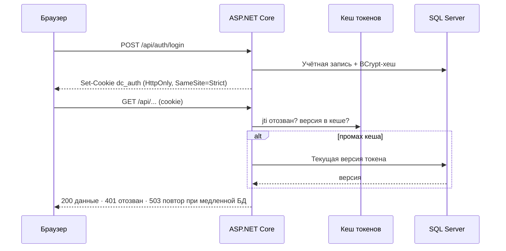

<div align="center">



<p>
  <strong>Платформа стоматологической клиники, спроектированная как продукт, а не как демо.</strong><br>
  <sub>Онлайн-запись · CRM заявок · уведомления в реальном времени · защищённые сессии · маршрут на странице · AI-ассистент · 5 языков</sub>
</p>

<p>
  <a href="README.md"></a>
  <a href="README.ru.md"></a>
</p>

<p>
  <a href="https://dental-clinic-vn.vercel.app/"></a>
  <a href="docs/README.ru.md"></a>
  <a href="docs/ARCHITECTURE.md"></a>
  <a href="docs/API.md"></a>
  <a href="docs/SECURITY.md"></a>
</p>

<p>
  <a href="https://github.com/ViolettaNcl/DentalClinic/actions/workflows/ci.yml"></a>
  <a href="https://github.com/ViolettaNcl/DentalClinic/actions/workflows/e2e.yml"></a>
  <a href="https://github.com/ViolettaNcl/DentalClinic/actions/workflows/codeql.yml"></a>
  <a href="https://github.com/ViolettaNcl/DentalClinic/actions/workflows/production-smoke.yml"></a>
  
  <a href="LICENSE"></a>
</p>

<p>
  <a href="#showcase">Витрина</a> ·
  <a href="#features">Возможности</a> ·
  <a href="#whats-new">Что нового</a> ·
  <a href="#architecture">Архитектура</a> ·
  <a href="#quality">Качество</a> ·
  <a href="#quick-start">Быстрый старт</a> ·
  <a href="#documentation">Документация</a>
</p>

</div>


<a id="showcase"></a>
## 🎬 Витрина

<p align="center">
  
</p>

<p align="center"><sub>Реальные экраны текущей сборки: главная, каталог услуг, профили врачей и маршрут, построенный прямо на странице контактов, — рядом мобильная версия.</sub></p>

<a id="features"></a>
## ✨ Возможности

<table>
<tr>
<td width="33%" valign="top">

### 🌐 Публичный сайт
- Каталог услуг с актуальными ценами
- Профили врачей и запись в один клик
- Гостевая заявка на приём
- **Маршрут на странице** (машина · пешком · транспорт)
- Отзывы с модерацией и переводом
- 5 языков, включая арабский **RTL**

</td>
<td width="33%" valign="top">

### 👤 Кабинет пациента
- Регистрация и защищённые сессии
- История записей и статусы
- Перенос и отмена по правилам клиники
- Профиль, аватар, смена пароля
- Отзывы после завершённых визитов
- Уведомления **в реальном времени** (SignalR)

</td>
<td width="33%" valign="top">

### 🏥 Работа клиники
- CRM заявок и записи по телефону
- Врачи, услуги и расписания
- Календарь с учётом доступности
- Аналитика, XLSX и печатные отчёты
- Несколько админов и защита суперадмина
- Автоматические напоминания и follow-up

</td>
</tr>
<tr>
<td valign="top">

### 🤖 Ассистент «Дента»
- Сначала — факты клиники из SQL
- Gemini со структурированными ответами
- Разрешённые ссылки, безопасная запись
- Правила медицинской безопасности, голос

</td>
<td valign="top">

### 🛡 Безопасность
- JWT в cookie `HttpOnly` + `SameSite=Strict`
- Отзыв токена при выходе и по версии
- Проверка происхождения, CORS allow-list
- Лимиты + распределённые SQL-квоты

</td>
<td valign="top">

### ✨ Продуманный UX
- Анимации: появление, наклон, волна, свечение
- Симметричная шапка, mobile-first вёрстка
- Без горизонтальной прокрутки от 320 px до 4K
- Учитывается `prefers-reduced-motion`

</td>
</tr>
</table>

<a id="whats-new"></a>
## 🚀 Что нового

| | Изменение | Почему это важно |
|:-:|---|---|
| 🔐 | **Надёжный вход пациента на нескольких экземплярах.** Выход отзывает только текущий токен (`jti`); задержка БД при проверке сессии даёт повторяемый `503` вместо `401`. | Свежий вход и регистрация больше не отклоняются другим экземпляром Vercel, а медленные запросы не разлогинивают пациента. |
| 🗺 | **Маршрут прямо на странице контактов.** Карта переведена на виджет Яндекс.Карт: реальные маршруты на машине, пешком и на транспорте, плюс кнопка «открыть в навигаторе». | Старое встраивание Google больше не работало и показывало пустую карту. |
| ✨ | **Слой анимаций для всего сайта.** Появление при прокрутке, частицы и свечение в hero, 3D-наклон карточек, «волна» и блик, счётчики и модальные окна. | Премиальное ощущение на одном CSS-файле и одном отложенном скрипте — без фреймворков. |
| 📐 | **Симметричная шапка и адаптив.** Меню по центру на десктопе; элементы шапки работают с первой отрисовки. | Одинаково аккуратно на любом экране; устранена гонка в E2E-тесте переключателя языка. |
| ⚡ | **Безопасный кеш статики.** HTML, JS, CSS и словари перепроверяются через `ETag`. | После деплоя у посетителей не остаётся устаревшая смесь ES-модулей. |

Полная история: [CHANGELOG.md](CHANGELOG.md).


<a id="architecture"></a>
## 🏗 Архитектура

<p align="center">
  
</p>

Один развёртываемый **модульный монолит на ASP.NET Core 10** отвечает за статический фронтенд, REST API, SignalR, фоновые процессы и доступ к данным. Контроллеры решают HTTP-задачи, доменные сервисы — бизнес-правила, а ограничения SQL служат последним рубежом: ни один слой не является единственной защитой.

<details>
<summary><strong>Поток запроса и сессии (Mermaid)</strong></summary>



</details>

Подробнее: [руководство по архитектуре](docs/ARCHITECTURE.md) — границы доверия, потоки запросов и ключевые решения.

## 🧰 Технологии

| Слой | Стек |
|---|---|
| **Backend** |     |
| **Данные** |    |
| **Безопасность** |    |
| **Frontend** |     |
| **Интеграции** |    |
| **Поставка** |     |
| **Тесты** |     |

<a id="quality"></a>
## ✅ Контроль качества

<table>
<tr>
<td align="center" width="25%"><h3>488</h3><sub>модульных и интеграционных<br>.NET-тестов</sub></td>
<td align="center" width="25%"><h3>200</h3><sub>регрессионных<br>JS-тестов</sub></td>
<td align="center" width="25%"><h3>19</h3><sub>E2E-проверок Playwright<br>десктоп + мобильный</sub></td>
<td align="center" width="25%"><h3>6 ч · 24 ч</h3><sub>плановые проверки<br>production: smoke · E2E</sub></td>
</tr>
</table>

| Workflow | Что проверяет |
|---|---|
| **CI** | Release-сборку и полный набор .NET-тестов при каждом пуше |
| **Production E2E** | Здоровье, канонические URL, доступность (axe), языки и RTL, горизонтальную прокрутку, чат — на десктопе и телефоне |
| **CodeQL** | Статический анализ безопасности C# и JavaScript |
| **Production smoke** | Плановые проверки здоровья и публичных страниц живого сайта |
| **CD** | Тестовый барьер, публикацию образа в GHCR, опциональную доставку по FTPS |


<a id="quick-start"></a>
## ⚡ Быстрый старт

> **Нужно:** [.NET SDK 10](https://dotnet.microsoft.com/download/dotnet/10.0) · SQL Server 2019+ или Azure SQL · Git · по желанию Node.js 22 (тесты) и Docker Desktop

```bash
git clone https://github.com/ViolettaNcl/DentalClinic.git
cd DentalClinic
cp appsettings.Example.json appsettings.json   # PowerShell: Copy-Item appsettings.Example.json appsettings.json
dotnet tool restore && dotnet restore
dotnet ef database update
dotnet run --launch-profile http                # → http://localhost:5192 · Swagger на /swagger
```

Перед запуском замените в `appsettings.json` примеры строки подключения, JWT, адресов и данных клиники — настоящие секреты коммитить нельзя.

<details>
<summary><strong>🐳 Запуск через Docker Compose</strong></summary>

```bash
cp .env.example .env      # замените все заглушки
docker compose up --build # → http://localhost:8080 · SQL Server на localhost:1433
```

</details>

<details>
<summary><strong>🧪 Запуск тестов</strong></summary>

```bash
dotnet test DentalClinic.Tests/DentalClinic.Tests.csproj --configuration Release
npm install
npm run test:js
npx playwright install chromium
npm run test:e2e                      # по умолчанию проверяет живой сайт
BASE_URL=http://localhost:5192 npx playwright test   # или локальное/согласованное окружение
```

</details>

<details>
<summary><strong>⚙️ Справочник настроек</strong></summary>

Переменные окружения используют `__` для вложенных ключей, например `Jwt__Key`.

| Параметр | Назначение | Требование |
|---|---|---|
| `ConnectionStrings__DefaultConnection` | Подключение к SQL Server | Обязательно |
| `Jwt__Key` | Секрет подписи HMAC, ≥ 32 байт UTF-8 | Обязательно |
| `Jwt__Issuer`, `Jwt__Audience` | Границы проверки токена | Обязательно |
| `AllowedOrigins__0` | Доверенный адрес браузера | Вне same-origin по умолчанию |
| `Clinic__Phone`, `__Email`, `__Address`, `__Hours` | Публичные контакты на сайте и карте | Обязательно для production |
| `Clinic__Latitude`, `Clinic__Longitude` | Точная точка на карте и локальная оценка времени в пути | Рекомендуется |
| `Scheduling__*` | Часовой пояс, часы работы, шаг слотов, запас времени | Рекомендуется |
| `Gemini__ApiKey` | «Дента» и перевод отзывов | Обязательно для AI-функций |
| `ElevenLabs__ApiKey` | Голосовые ответы | Опционально |
| `CRON_SECRET` | Аутентификация служебных маршрутов Vercel | Обязательно на Vercel |

Перед настройкой общего или production-окружения прочитайте раздел [Безопасность](docs/SECURITY.md).

</details>

## 🧭 Эксплуатационные границы

- **Медицинская безопасность** — «Дента» и Smile Meter носят информационный характер и не ставят диагноз и не планируют лечение.
- **Эксплуатация** — нужны управляемые оператором секреты, внешняя БД и отдельно выданный доступ администраторов.
- **Известные ограничения** — пока нет MFA и восстановления пароля для администраторов; для нескольких экземпляров SignalR нужен backplane; отзыв токена при выходе действует в пределах экземпляра. Подробнее — в разделе [Безопасность](docs/SECURITY.md).
- **Развёртывание** — Git-деплой Vercel приостановлен в `vercel.json`; production обновляется вручную, а GitHub Actions работают при каждом пуше. Готов бесплатный вариант на **Render** через [`render.yaml`](render.yaml) — см. [руководство по развёртыванию](docs/DEPLOYMENT.md#бесплатный-хостинг-на-render-вместо-vercel).

<a id="documentation"></a>
## 📚 Документация

| | Руководство | Русский | English |
|:-:|---|:-:|:-:|
| 🏗 | Архитектура — компоненты, границы доверия, потоки данных | [Открыть](docs/ARCHITECTURE.md) | [Open](docs/en/ARCHITECTURE.md) |
| 📡 | REST API — маршруты, права доступа, лимиты, ошибки | [Открыть](docs/API.md) | [Open](docs/en/API.md) |
| 🗃 | Словарь данных — сущности, ограничения, хранение | [Открыть](docs/DATA_DICTIONARY.md) | [Open](docs/en/DATA_DICTIONARY.md) |
| 👨‍💻 | Руководство разработчика — запуск, миграции, тесты | [Открыть](docs/DEVELOPER_GUIDE.md) | [Open](docs/en/DEVELOPER_GUIDE.md) |
| 🚀 | Развёртывание — Vercel, Docker, cron, проверки выпуска | [Открыть](docs/DEPLOYMENT.md) | [Open](docs/en/DEPLOYMENT.md) |
| 🔒 | Безопасность — меры защиты, секреты, остаточные риски | [Открыть](docs/SECURITY.md) | [Open](docs/en/SECURITY.md) |
| 👤 | Руководство пациента — посетители и пациенты | [Открыть](docs/USER_GUIDE.md) | [Open](docs/en/USER_GUIDE.md) |
| 👑 | Руководство администратора — клиника и суперадмин | [Открыть](docs/ADMIN_GUIDE.md) | [Open](docs/en/ADMIN_GUIDE.md) |

Начните с [центра документации](docs/README.ru.md). Участие: [CONTRIBUTING.md](CONTRIBUTING.md) · планы: [ROADMAP.md](ROADMAP.md) · уязвимости: [SECURITY.md](SECURITY.md) · история: [CHANGELOG.md](CHANGELOG.md).

<br>


<div align="center">
<sub>Автор и сопровождение — <a href="https://github.com/ViolettaNcl">Violetta Nicolaou</a> · распространяется по <a href="LICENSE">лицензии MIT</a> · если проект был полезен, поставьте ⭐.</sub>
</div>
