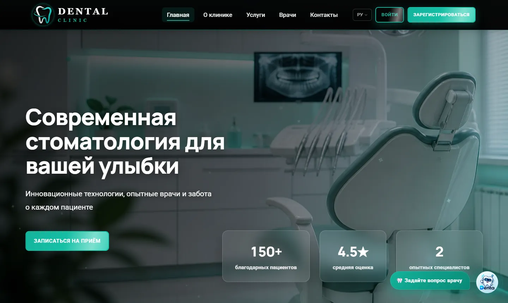
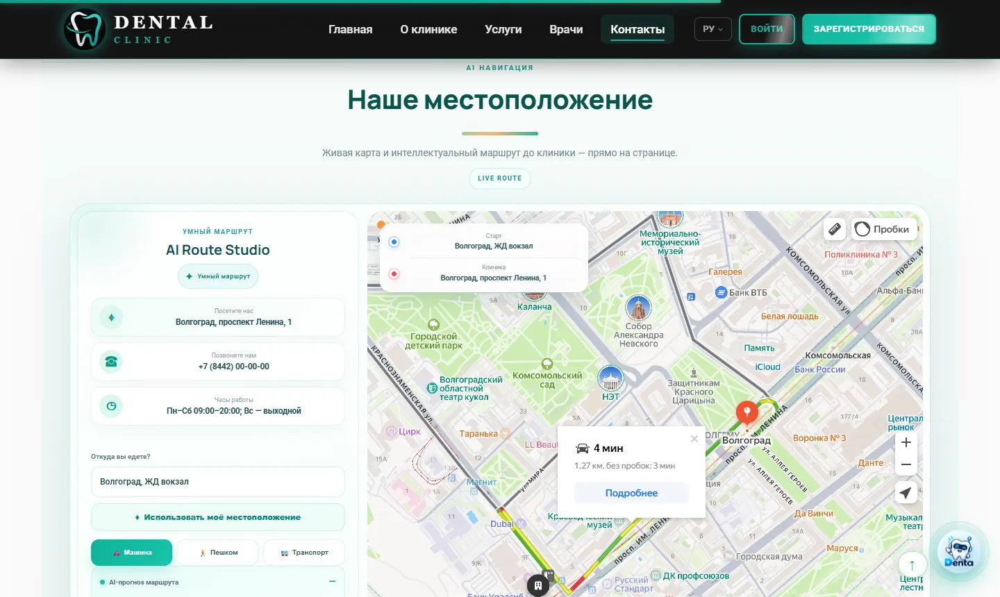
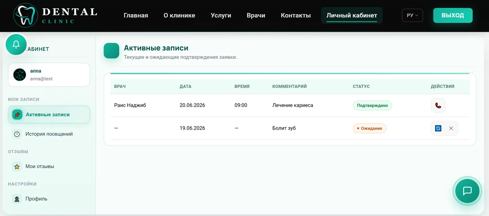
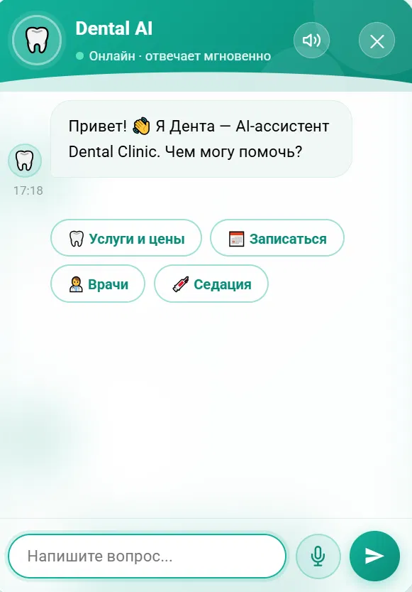
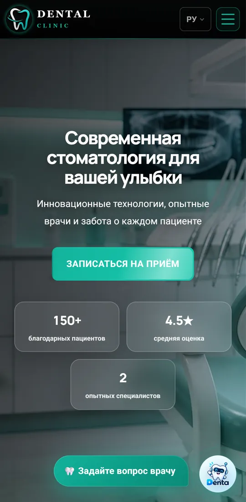

# Руководство пользователя

[Документация](README.ru.md) · [English](en/USER_GUIDE.md)

Сайт позволяет посмотреть услуги, цены, профили врачей и отзывы, отправить заявку на приём и следить за ней в личном кабинете. Интерфейс доступен на русском, английском, французском, греческом и арабском языках.

## Как добраться до клиники

Внизу страницы **«Контакты»** находится интерактивная карта клиники с построением маршрута:

1. Введите адрес отправления или нажмите **«Использовать моё местоположение»** и разрешите геолокацию в браузере.
2. Выберите способ: **машина**, **пешком** или **транспорт**.
3. Нажмите **«Построить на этой карте»** — маршрут, расстояние и время в пути появятся прямо на странице; карту можно двигать и масштабировать.
4. На телефоне кнопка **«Открыть маршрут в Яндекс Картах / навигаторе»** передаёт тот же маршрут в приложение.

Кнопка **«Показать только клинику»** возвращает исходный вид. Точка отправления передаётся Яндекс.Картам только при построении маршрута или открытии его в приложении; «AI-оценка» рядом с картой рассчитывается локально в браузере и является ориентировочной.

## Запись на приём

1. Заполните форму: имя, телефон, желаемую будущую дату и комментарий.
2. Отправьте заявку.
3. Дождитесь подтверждения клиники: отправленная форма ещё не означает, что приём назначен.

Без регистрации заявкой управляет администратор. Она не привязывается автоматически к аккаунту, созданному позже. Для просмотра истории и получения уведомлений войдите в аккаунт перед отправкой.

## Регистрация и вход

Укажите имя, email и пароль. Пароль должен содержать минимум восемь символов, включая заглавную и строчную буквы, цифру и специальный символ.

После регистрации вход выполняется автоматически. На общем устройстве завершайте работу кнопкой выхода: она сразу удаляет cookie сессии и отзывает эту сессию на сервере. После смены пароля потребуется войти снова.

Если база данных клиники на мгновение отвечает медленно, сайт сам повторит проверку сессии и не выведет вас из аккаунта. Если страница всё же сообщает, что сеанс проверить не удалось, обновите её через несколько секунд.

## Личный кабинет

В кабинете доступны заявки, отзывы, уведомления и профиль.

| Статус заявки | Что означает | Доступное действие |
|---|---|---|
| `pending` | Ожидает подтверждения | Отмена или перенос на другую будущую дату |
| `confirmed` | Клиника подтвердила врача и время | Для изменения свяжитесь с клиникой |
| `completed` | Приём завершён | Просмотр истории |
| `cancelled` | Заявка отменена | Для новой записи отправьте заявку или свяжитесь с клиникой |

Можно изменить имя и телефон, сменить пароль, добавить или удалить аватар. Поддерживаются JPG, PNG и WebP размером до 3 МБ.

## Уведомления

Колокольчик показывает подтверждение, отмену и завершение записи, напоминания, просьбу оставить отзыв и результат модерации. Время напоминания зависит от настроек клиники и расписания фоновых задач.

При потере соединения обновите страницу, чтобы загрузить сохранённые уведомления. Их можно прочитать или удалить; удаление уведомления не отменяет запись на приём.

## Отзывы

Войдите в аккаунт, поставьте оценку от 1 до 5 и напишите отзыв длиной от 10 до 1000 символов. Отзыв появится на сайте после одобрения администратора. При отклонении причина будет доступна в кабинете.

Не публикуйте личные контакты и сведения о других людях. Перевод отзывов использует внешний AI-сервис и может быть временно недоступен.

## Ассистент «Дента»

«Дента» помогает найти услуги, цены, врачей и опубликованную информацию о клинике, перейти к нужной странице или оформить заявку. Озвучивание и голосовой ввод зависят от браузера и настроенных сервисов.

Ассистент предоставляет справочную информацию и не заменяет консультацию врача. Цены на сайте и визуализация Smile Meter не являются индивидуальным планом лечения или гарантией результата.

## Язык и поддержка

Используйте переключатель в шапке сайта. Для арабского включается направление справа налево.

На сайте используются деликатные анимации (появление блоков, эффекты наведения, счётчики). Если в системе включено **«Уменьшить движение»**, они автоматически отключаются. Вёрстка проверена на ширинах от 320 px до больших мониторов без горизонтальной прокрутки.

По вопросам записи и аккаунта обращайтесь по контактам, указанным на сайте клиники. Ошибку приложения можно сообщить через GitHub Issues: укажите страницу, браузер, язык и действия, после которых возникла проблема. Не прикладывайте пароли или персональные данные. Для уязвимостей действует отдельная [политика безопасности](../SECURITY.md).
